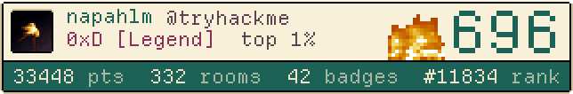
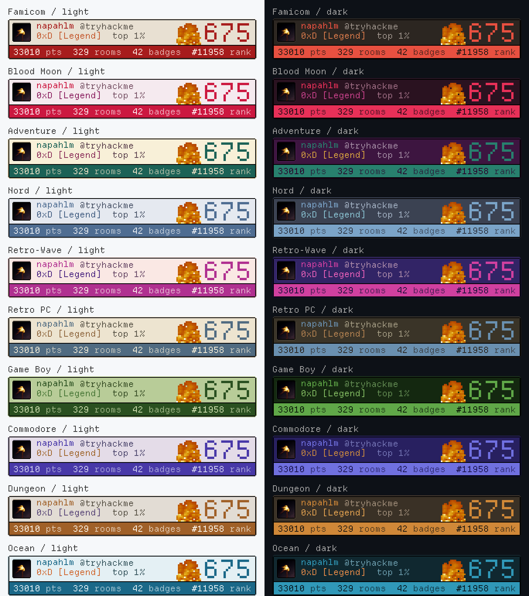

# thm-badge-generator

A pixel-art TryHackMe profile badge for your GitHub README, drawn in the [Gribble](https://gribble.app) pixel editor style and refreshed every day by a GitHub Action.

<a href="https://tryhackme.com/p/napahlm">
  <picture>
    <source media="(prefers-color-scheme: dark)" srcset="badges/thm-adventure-dark.gif">
    
  </picture>
</a>

Level, points, rooms, badges, global rank and streak come from your public TryHackMe profile.
The card uses [Departure Mono](https://departuremono.com), Gribble's PixelFrame bevels and ten Gribble themes, each in light and dark.
The streak fire is animated.



## Use it

Add this file to your profile repository (the repo named after your GitHub user) as `.github/workflows/thm-badge.yml`, with your TryHackMe username:

```yaml
name: TryHackMe badge
on:
  schedule:
    - cron: "23 0 * * *"
  workflow_dispatch:
permissions:
  contents: write
jobs:
  badge:
    runs-on: ubuntu-latest
    steps:
      - uses: actions/checkout@v4
      - uses: napahlm/thm-badge-generator@v1
        with:
          username: your-thm-username
          theme: adventure
```

Go to the Actions tab and run it once with "Run workflow".
It writes the badge into `badges/` in your repo and commits it, then runs by itself every day.

Then put this in your README:

```html
<a href="https://tryhackme.com/p/your-thm-username">
  <picture>
    <source media="(prefers-color-scheme: dark)" srcset="badges/thm-adventure-dark.gif">
    
  </picture>
</a>
```

The `<a>` makes the whole badge a link to your profile.
The `<picture>` switches between light and dark to match the viewer's GitHub theme.
`badges/embed.html` contains this snippet already filled in for you, with absolute URLs for use outside the repo.
Use `.png` instead of `.gif` for a still badge.

## Options

| input | default | what it does |
| --- | --- | --- |
| `username` | required | TryHackMe username |
| `theme` | `adventure` | `adventure`, `famicom`, `bloodmoon`, `nord`, `retrowave`, `retropc`, `gameboy`, `commodore`, `dungeon`, `ocean` |
| `mode` | `both` | `light`, `dark` or `both` |
| `scale` | `2` | integer upscale; the native card is about 322x53 px |
| `animate` | `true` | also write the GIF, the spritesheet and its CSS |
| `frame` | `risen` | outer frame style: `risen`, `sunken`, `normal`, `blackBorder` |
| `out_dir` | `badges` | where the files go in your repo |
| `extra_args` | | extra flags, for example `--no-avatar` |
| `commit` | `true` | set to `false` to handle the commit yourself |

## On your own site

Next to each GIF the action writes `thm-<theme>-<mode>-sprite.png` (one row of 20 frames, transparent background) and a matching `.css` file.
Include the CSS and add `<a class="thm-badge" href="https://tryhackme.com/p/your-thm-username"></a>`.
The animation runs with `steps(20)`, keeps the pixels sharp, and stops under `prefers-reduced-motion`.

## Run it locally

```sh
pip install pillow
python thm_badge.py --username your-thm-username
python thm_badge.py --username your-thm-username --theme gameboy --mode dark --scale 3 --animate
python thm_badge.py --username your-thm-username --all-themes --sheet
python demo_variants.py
```

`demo_variants.py` renders a sheet of edge cases (long names, 0 and 9999 streaks, every title) so layout changes can be checked without fetching anything.

## How it works

- Stats come from `https://tryhackme.com/api/v2/public-profile?username=<name>`, the JSON behind TryHackMe's own badge.
- The card is drawn at native pixel resolution with hard, unantialiased text and scaled up with nearest-neighbour.
- Frames are Gribble's PixelFrame pixel maps, 9-sliced the same way the app does it.
- Themes are generated from Gribble's theme CSS with `themes_from_css.py`.
- The avatar is downscaled to 22x22 and reduced to 48 colours so it reads as a sprite.
- If the fetch fails or the API changes shape, the script exits non-zero and nothing is committed, so your README keeps the last good badge.

## Credits

- Departure Mono by Helena Zhang and Tobias Fried, MIT, see `fonts/LICENSE-DepartureMono.txt`.
- Theme palettes and PixelFrame from [Gribble](https://gribble.app).
- Fire sprite from Minecraft, property of Mojang; used here as a decorative asset.

## Licence

MIT, except the files credited above, which keep their own terms.